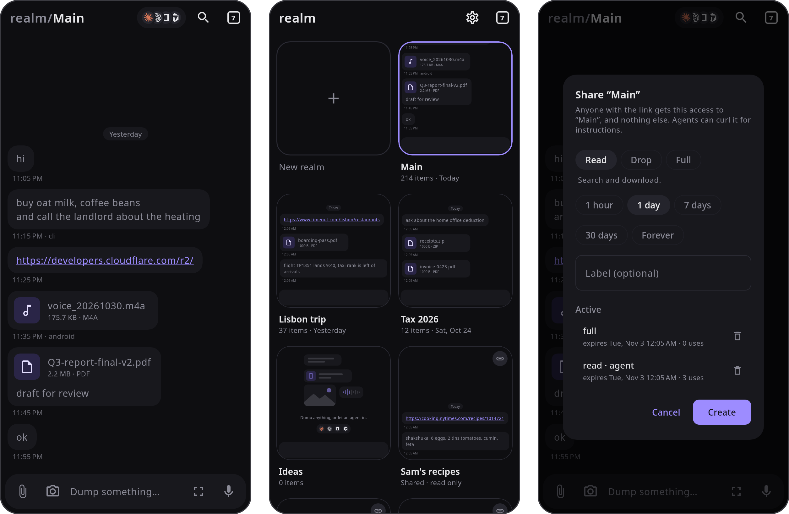

# realm

realm is a personal dump for notes and files. Anything you type, paste, drop, or record lands in a searchable realm, and a share link gives a friend or an agent access without a login. One deployment holds as many realms as you like.

<p align="center"></p>

The server is a Cloudflare Worker in `worker/`. It keeps files in R2 and items in D1. The app runs on Android and desktop, with client logic in `app/core/` and the Compose UI in `app/shared/`. The CLI in `cli/` is written in Go.

`nix-shell` provides JDK 21, Go, Node, and ktlint. Without Nix, install JDK 17, Go 1.24, and Node 22, or later. Read [CONTRIBUTING.md](CONTRIBUTING.md) before you commit.

## Deploy the worker

Run the app and log in with Cloudflare. The app lists what the account still needs, then deploys the worker from the newest GitHub release, never a release candidate. Settings offers updates and manages the worker's addresses.

To deploy by hand:

```sh
cd worker
npm install
npx wrangler login
npm run deploy      # creates the R2 bucket and D1 database
```

Then log in from the app or with `realm login`. Any Cloudflare login that can manage the worker owns it. The worker upgrades its own tables, so to upgrade, redeploy.

For scripts that can't log in through a browser, set an owner token: `openssl rand -base64 32 | tee /dev/stderr | npx wrangler secret put REALM_TOKEN`. `npm run serve` runs the worker locally with in-memory storage and the token `dev`.

To fork realm, set `FORK` in `worker/src/common.ts` and `Api.FORK` in `app/core/src/commonMain/kotlin/realm/Api.kt`. The app then deploys your fork's releases and never replaces a worker that runs another fork. To let the app update itself from your releases, make an ECDSA P-256 key and put its public half in `Api.APP_KEY` and its private half in the secret `APP_SIGNING_KEY`.

## Run the app

```sh
cd app
./gradlew :desktopApp:run       # REALM_LOG=debug logs more
./gradlew :androidApp:installDebug
```

The desktop app keeps its state in `realm/app.json` in the OS config folder, such as `~/.config` on Linux.

## Use the CLI

```sh
cd cli && make
realm login
realm add buy oat milk
realm add ~/Downloads/*.pdf -t receipts
realm ls invoice -k file
realm link --read --ttl 1d
```

`realm realms add <link>` adds a realm someone shared with you, to use like your own, with or without a login of your own. Run `realm` alone to list every command.

## Share links

A link at `https://…/s/<token>` opens one realm. It can expire, run out of uses, or cap how much it uploads.

| Scope  | Allows                                   |
|--------|------------------------------------------|
| `drop` | Adding notes and files                   |
| `read` | Listing, searching, and downloading      |
| `full` | Everything except managing links         |

A `read` link can share a selection of items instead of the whole realm. Fetched with curl, a link returns markdown instructions for what it allows. In a browser, it shows an upload page or a searchable list. The owner API is the same under `/api/realms/<id>/` with `Authorization: Bearer $REALM_TOKEN`.

## Limits

- Cloudflare caps a Worker request body at about 100 MB, so the CLI and the app upload larger files in parts.
- Search matches note text, captions, and file names, not file contents.
- `wrangler d1 export` skips the search index. After a restore, run `INSERT INTO items_fts(items_fts) VALUES('rebuild')`.
