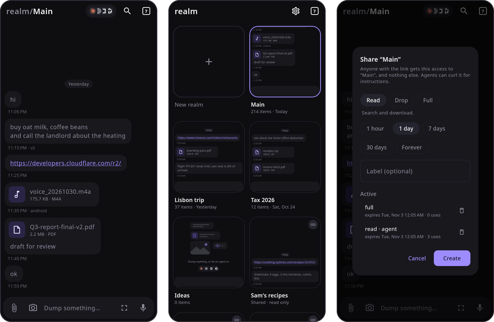

# realm

realm is a personal dump for notes and files. Anything you type, paste, drop, or record lands in a searchable realm, and a share link gives a friend or an agent access without a login. One deployment holds as many realms as you like.

<p align="center"></p>

```
worker/       Cloudflare Worker API. R2 stores files, D1 stores items and the search index.
app/core/     Client logic without UI, shared by the app and a future Kotlin CLI.
app/shared/   Compose Multiplatform UI on top of core, for Android and desktop.
cli/          Go CLI, maintained but not extended. It does a subset of what the app does.
```

`nix-shell` in the repo root provides JDK 21, Go, Node, and ktlint. Without Nix, install JDK 17 or later with `JAVA_HOME` set, Go 1.24 or later, and Node 22 or later.

Before committing, read [CONTRIBUTING.md](CONTRIBUTING.md) and run `git config core.hooksPath .githooks` once.

## Deploy the worker

The app deploys the worker for you. Run the app, log in with Cloudflare, and pick the account. If the account has no realm worker, you stay logged in and the app lists what deploying needs: R2 turned on in the Cloudflare dashboard, a workers.dev subdomain, room for a D1 database (the free plan allows 10), and a released worker. It checks each one and deploys once all are met. You pick the address, either workers.dev or a domain on your Cloudflare account.

The app deploys the worker built for the newest GitHub release, tagged `vX.Y.Z`. It never deploys a `vX.Y.Z-rc.N` pre-release. When a newer release is out, Settings offers the update. The app checks once a day, and **Check for updates** checks now. Settings also adds and removes domains, turns workers.dev on and off, and switches the address the app uses.

To deploy by hand instead:

```sh
cd worker
npm install
npx wrangler login
npm run deploy      # creates the R2 bucket and D1 database
```

Then log in with Cloudflare from the app, or run `realm login` from the CLI. Logging in finds the worker and tells it which account it runs on. From then on, any Cloudflare login that can manage the worker is its owner, so there's no token to keep. The worker sets up and upgrades its own tables on the first request, so redeploying is the whole upgrade. The Go CLI logs in but doesn't deploy.

For scripts or agents that can't log in through a browser, you can also give the worker a fixed owner token: `openssl rand -base64 32 | tee /dev/stderr | npx wrangler secret put REALM_TOKEN`. To run the worker locally with in-memory storage and the token `dev`, run `npm run serve`.

`GET /api/info` reports the worker's `version` and, for a fork, its `fork` as `owner/repo`. To fork realm, set `FORK` in `worker/src/common.ts` and `Api.FORK` in `app/core/src/commonMain/kotlin/realm/Api.kt`. The app then deploys your fork's releases, and it never replaces a worker that runs another fork.

## Use the CLI

```sh
cd cli && make
realm login
realm add buy oat milk
realm realms add Tax 2026
realm use tax
realm add ~/Downloads/*.pdf -t "receipts"
realm -r main ls invoice -k file
realm get last
realm link --read --ttl 1d
```

`realm connect <link>` uses a share link instead of your own server, and `realm get <link>` downloads a link to one file without connecting. Deleting asks first; `-y` skips the question. Run `realm` with no arguments for the full command list.

## Run the app

```sh
cd app
./gradlew :desktopApp:run
./gradlew :androidApp:installDebug
```

The desktop app logs warnings to the terminal. For more detail, run it as `REALM_LOG=debug ./gradlew :desktopApp:run`.

On first launch, log in with Cloudflare. If your account has no realm worker yet, the app offers to deploy one. You can also connect with the worker URL and an owner token, or with a share link. The app opens on your Main realm. The tabs button in the corner zooms out to all your realms, like a browser's tab overview, and share links you connect show up there as tiles too. The agent icons share the realm you have open.

## Share links

Each link opens one realm at `https://…/s/<token>` and can have an expiry and a use limit. Links that can upload can also have a size budget.

| Scope  | Allows                                   |
|--------|------------------------------------------|
| `drop` | Adding notes and files                   |
| `read` | Listing, searching, and downloading      |
| `full` | Everything except managing links         |

A `read` link can also share just a selection of items, and you can change the selection later. A selection of one item downloads straight from the link. `GET /s/<token>/info` describes a link without using it up.

Fetched with curl, a link returns markdown instructions for exactly what it allows. In a browser, a drop link shows an upload page and a read link shows a searchable list. The owner API is the same at `/api/realms/<id>/` with `Authorization: Bearer $REALM_TOKEN`. Realms are listed and created at `/api/realms`, and the plain `/api/` routes use your first realm.

## Limits

- A Worker request carries about 100 MB, so larger files upload in parts. The CLI and the app do this for you.
- Search matches note text, captions, and file names, not file contents.
- `wrangler d1 export` skips the search index. After a restore, run `INSERT INTO items_fts(items_fts) VALUES('rebuild')`.
