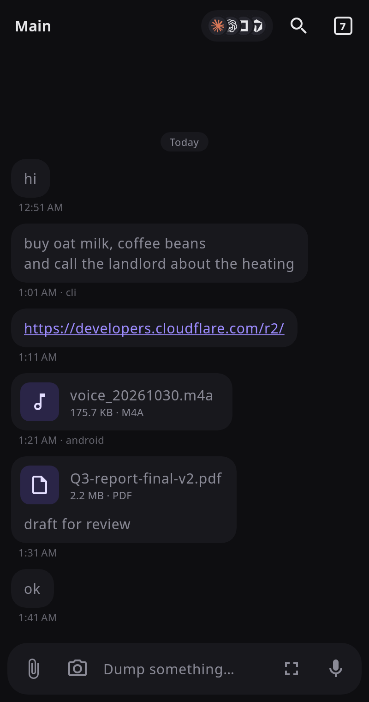
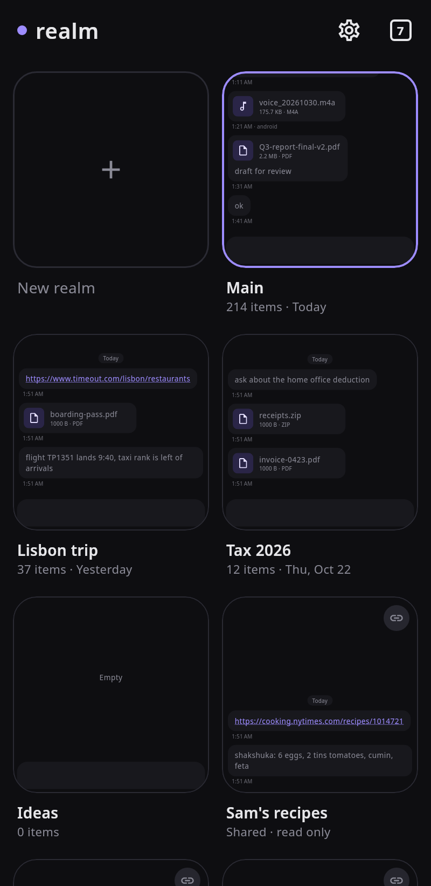
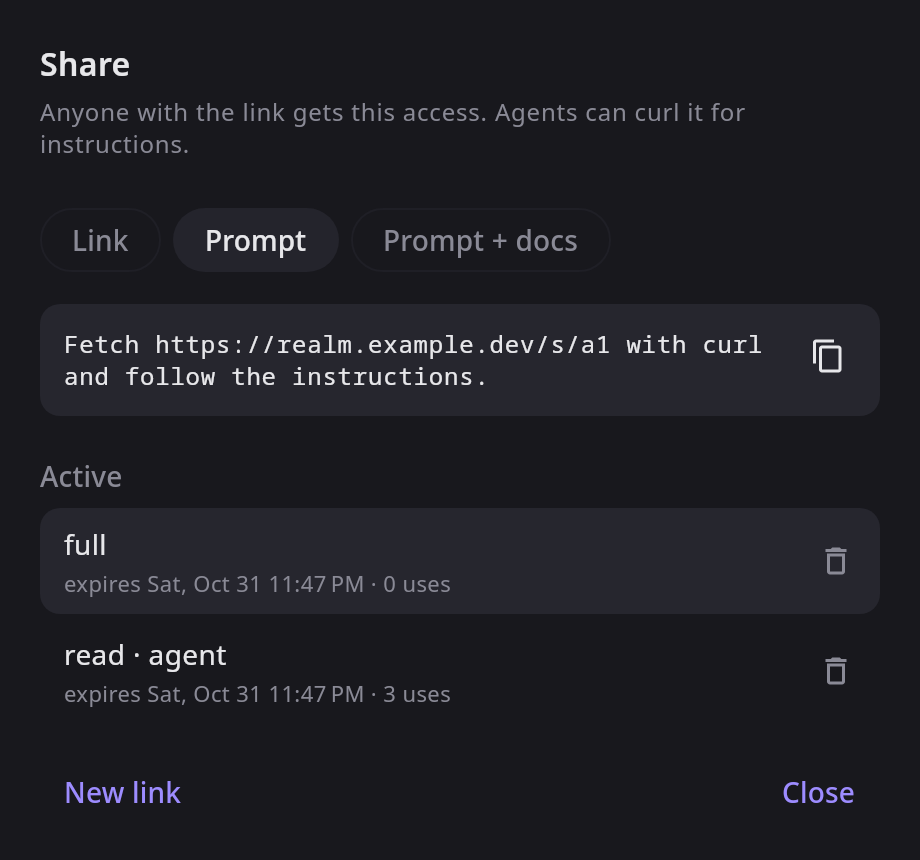

# realm

realm is a personal dump for notes and files. Anything you type, paste, drop, or record lands in a searchable realm, and a share link gives a friend or an agent access without a login. One deployment holds as many realms as you like.

<p>
  
  
  
</p>

```
worker/   Cloudflare Worker API. R2 stores files, D1 stores items and the search index.
cli/      Go CLI.
app/      Compose Multiplatform app for Android and desktop.
```

`nix-shell` in the repo root provides JDK 21, Go, and Node. Without Nix, install JDK 17 or later with `JAVA_HOME` set, Go 1.24 or later, and Node 22 or later.

## Deploy the worker

```sh
cd worker
npm install
npx wrangler login
npm run deploy      # creates the R2 bucket and D1 database
openssl rand -base64 32 | tee /dev/stderr | npx wrangler secret put REALM_TOKEN
```

The last command prints your owner token. The worker sets up and upgrades its own tables on the first request, so redeploying is the whole upgrade. To run the worker locally with in-memory storage and the token `dev`, run `npm run serve`.

## Use the CLI

```sh
cd cli && make
realm login https://realm.you.workers.dev <token>
realm add buy oat milk
realm add ~/Downloads/*.pdf -t "tax stuff"
realm ls invoice -k file
realm get last
realm link --read --ttl 1d
```

Run `realm` with no arguments for the full command list.

## Run the app

```sh
cd app
./gradlew :desktopApp:run
./gradlew :androidApp:installDebug
```

On first launch, sign in with the worker URL and owner token, or connect a share link. The app opens on your Main realm. The tabs button in the corner zooms out to all your realms, like a browser's tab overview, and share links you connect show up there as tiles too. The agent icons share the realm you have open.

## Share links

Each link opens one realm at `https://…/s/<token>` and can have an expiry and a use limit. Links that can upload can also have a size budget.

| Scope  | Allows                                   |
|--------|------------------------------------------|
| `drop` | Adding notes and files                   |
| `read` | Listing, searching, and downloading      |
| `full` | Everything except managing links         |

A `read` link can also share just a selection of items, and you can change the selection later. A selection of one item downloads straight from the link. `GET /s/<token>/info` describes a link without using it up.

Fetched with curl, a link returns markdown instructions for exactly what it allows. In a browser, a drop link shows an upload page and a read link shows a searchable list. The owner API is the same at `/api/realms/<id>/` with `Authorization: Bearer $REALM_TOKEN`. Realms are listed and created at `/api/realms`, and the plain `/api/` routes use your first realm.

## Limits

- A Worker request carries about 100 MB, so larger files upload in parts. The CLI and the app do this for you.
- Search matches note text, captions, and file names, not file contents.
- `wrangler d1 export` skips the search index. After a restore, run `INSERT INTO items_fts(items_fts) VALUES('rebuild')`.
